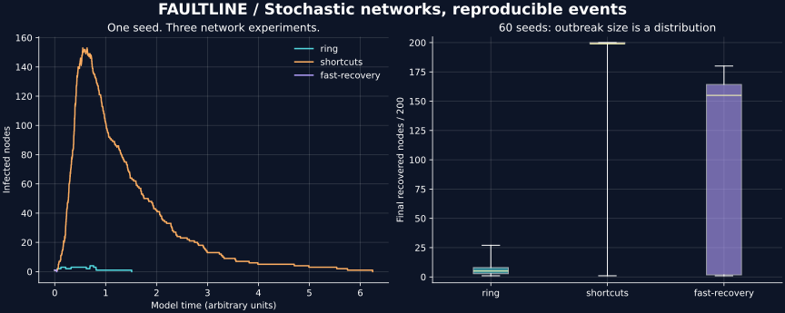

# Measured results

Generated by `python tools/experiment.py`. The CSV files retain every trial.

## Network experiments

Each scenario uses 200 nodes and the same 60 randomly sampled seeds. Shortcuts are attempts per node, not guaranteed edges. All runs include early extinction; results are not conditioned on large outbreaks.

| Scenario | Mean final R / 200 | Mean peak I | Final R range |
|---|---:|---:|---:|
| ring | 6.20 | 4.00 | 1–27 |
| shortcuts | 185.97 | 138.17 | 1–200 |
| fast-recovery | 97.12 | 29.35 | 1–180 |

The topology comparison also changes realized graph density: it does not isolate a pure shortcut effect. The recovery comparison holds generation parameters fixed. Sixty seeds describe this experiment, not a universal threshold or causal estimate.

## CLI performance

| Engine | Median milliseconds | Events |
|---|---:|---:|
| Python | 911.261 | 1199 |
| C | 14.587 | 1199 |

Measured Python/C ratio: **62.47×** on this machine.

Seven trials after one warm-up per engine. End-to-end wall time includes process startup, graph generation, simulation and CSV output captured in memory. The same arguments and events are used for both. C was compiled with O2; Python was CPython. Measurements are hardware- and workload-specific, with no CI performance threshold.

The lines show one seed (314159), not an average. The boxes show all 60 final sizes, including extinction; whiskers extend to extrema. Time is in arbitrary model units.
